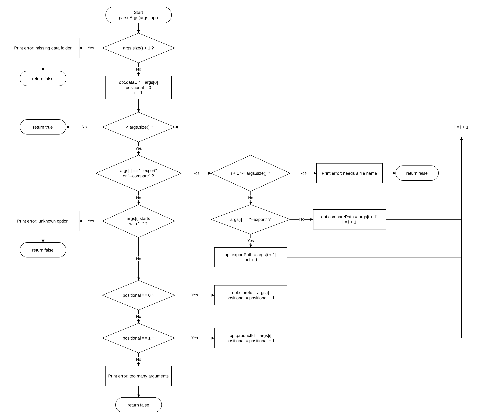

# T02 – parseArgs(args, opt)

Input: `args` (vector<string>, the command-line arguments without the program name), `opt` (Options, passed by reference).
Output: `true` if the arguments are valid (results written into `opt`), `false` if the syntax is wrong.

Syntax: `p1 <data_folder> [store_id] [product_id] [--export <file.csv>] [--compare <old_file.csv>]`

Pseudocode:

    IF args.size() < 1 THEN
        PRINT "Error: missing data folder" TO cerr
        RETURN false
    opt.dataDir = args[0]
    positional = 0
    FOR i = 1 TO args.size() - 1
        IF args[i] = "--export" OR args[i] = "--compare" THEN
            IF i + 1 >= args.size() THEN
                PRINT "Error: needs a file name" TO cerr
                RETURN false
            IF args[i] = "--export" THEN opt.exportPath = args[i + 1]
            ELSE opt.comparePath = args[i + 1]
            i = i + 1                      // skip the file name just read
        ELSE IF args[i] starts with "--" THEN
            PRINT "Error: unknown option" TO cerr
            RETURN false
        ELSE IF positional = 0 THEN
            opt.storeId = args[i]
            positional = positional + 1
        ELSE IF positional = 1 THEN
            opt.productId = args[i]
            positional = positional + 1
        ELSE
            PRINT "Error: too many arguments" TO cerr
            RETURN false
    RETURN true

Defaults (in struct Options): `storeId = "S001"`; an empty `productId`, `exportPath` or `comparePath` means the option is not used.

Tests:

| Command | Result |
| --- | --- |
| `bin/p1` | Prints "missing data folder" and Usage, exit code 1 |
| `bin/p1 data/sample` | Store S001 (default), no product |
| `bin/p1 data/sample S001 P003` | Store S001, Product P003 |
| `bin/p1 data/full S002 --export alerts.csv` | Store S002, Export alerts.csv |
| `bin/p1 data/full --export` | Prints "needs a file name", exit code 1 |
| `bin/p1 data/full --abc` | Prints "unknown option", exit code 1 |
| `bin/p1 data/full S001 P003 x` | Prints "too many arguments", exit code 1 |
