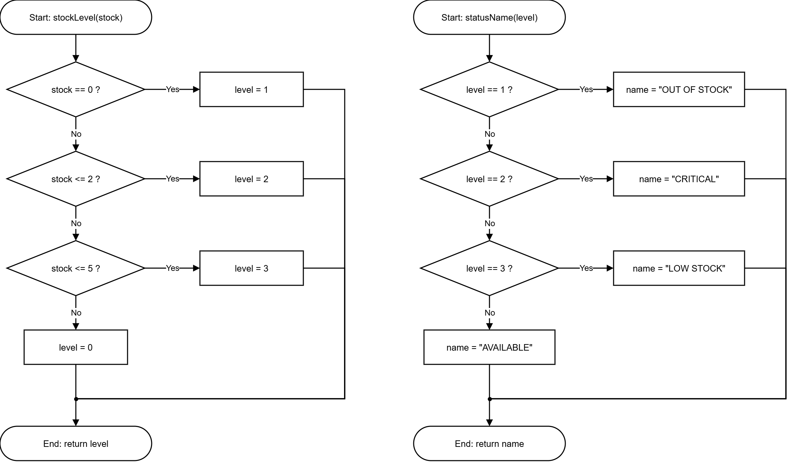

# T03 – stockLevel(stock)

Input: `stock` (integer, >= 0). Output: `level` = 1, 2, 3 or 0 (no alert).

Pseudocode:

    IF stock = 0 THEN level = 1
    ELSE IF stock <= 2 THEN level = 2
    ELSE IF stock <= 5 THEN level = 3
    ELSE level = 0
    RETURN level

## statusName(level)

Input: `level` (integer: 1, 2, 3 or 0). Output: `name` (string: `"OUT OF STOCK"`, `"CRITICAL"`, `"LOW STOCK"`, or `"AVAILABLE"`).

Pseudocode:

    IF level = 1 THEN name = "OUT OF STOCK"
    ELSE IF level = 2 THEN name = "CRITICAL"
    ELSE IF level = 3 THEN name = "LOW STOCK"
    ELSE name = "AVAILABLE"
    RETURN name

Tests (TC02 Boundaries & Sample Data):

| `stock` | `stockLevel(stock)` | `statusName(level)` | Meaning |
| --- | --- | --- | --- |
| `0` | `1` | `OUT OF STOCK` | Priority 1 (highest) — e.g. `P003` in `data/sample` (`stock = 0`) |
| `1` | `2` | `CRITICAL` | Priority 2 (lower bound) — e.g. `P006` in `data/sample` (`stock = 1`) |
| `2` | `2` | `CRITICAL` | Priority 2 (upper bound) — e.g. `P002` in `data/sample` (`stock = 2`) |
| `3` | `3` | `LOW STOCK` | Priority 3 (lower bound) — e.g. `P008` in `data/sample` (`stock = 3`) |
| `4` | `3` | `LOW STOCK` | Priority 3 — e.g. `P007` in `data/sample` (`stock = 4`) |
| `5` | `3` | `LOW STOCK` | Priority 3 (upper bound) — e.g. `P004` in `data/sample` (`stock = 5`) |
| `6` | `0` | `AVAILABLE` | No alert (lower bound for `in stock at:`) — e.g. `S001 P026` in `data/full` (`stock = 6`) |
| `8` | `0` | `AVAILABLE` | No alert — e.g. `P001` in `data/sample` (`stock = 8`) |
| `12` | `0` | `AVAILABLE` | No alert — e.g. `P005` in `data/sample` (`stock = 12`) |
