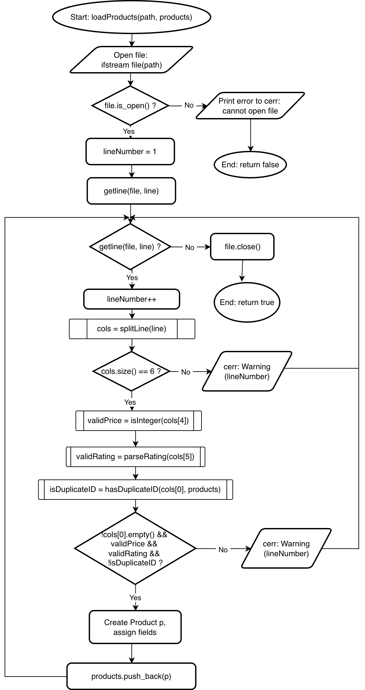
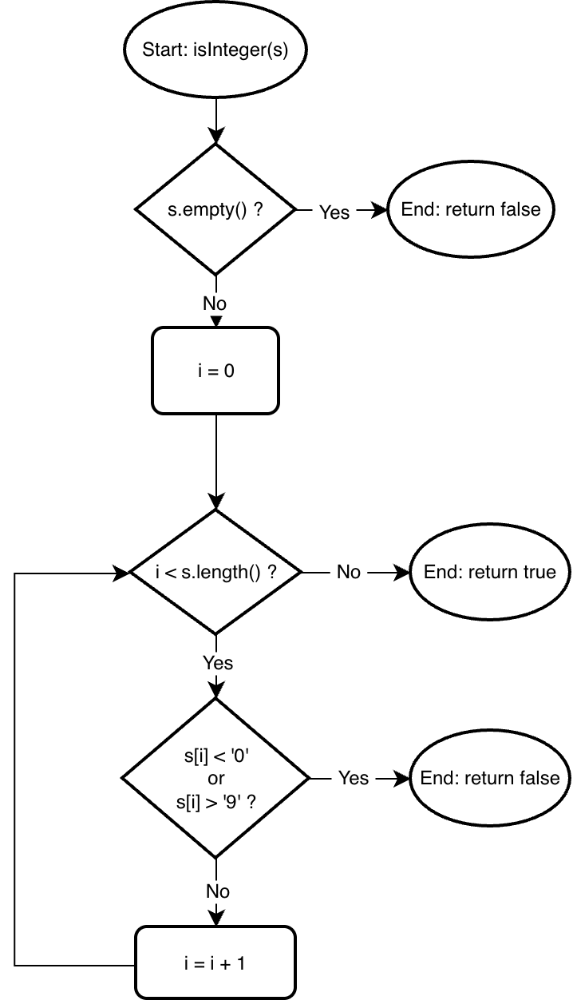
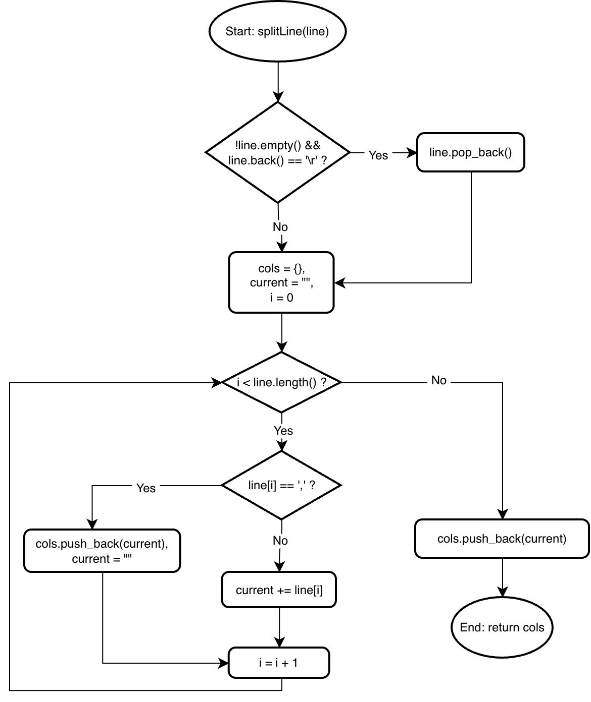

# T04 - Load Products (`loadProducts`, `splitLine`, `isInteger`)
- Input: `path` (`const std::string&`), `products` (`std::vector<Product>&`)
- Output: `bool` (`true` if the file opens and is processed, `false` if opening fails)
- Error Handling: Skip invalid or malformed rows and print warnings with `lineNumber` to `std::cerr` without terminating the program; keep the first record when a duplicate product ID is encountered.

Pseudocode

    FUNCTION isInteger(s)
        IF s.empty() THEN
            RETURN false
        END IF

        SET i = 0

        WHILE i < s.length()
            IF s[i] < '0' OR s[i] > '9' THEN
                RETURN false
            END IF

            SET i = i + 1
        END WHILE

        RETURN true
    END FUNCTION

    FUNCTION splitLine(line)
        IF NOT line.empty() AND line.back() == '\r' THEN
            line.pop_back()
        END IF

        SET cols = empty vector
        SET current = ""
        SET i = 0

        WHILE i < line.length()
            IF line[i] == ',' THEN
                cols.push_back(current)
                SET current = ""
            ELSE
                SET current = current + line[i]
            END IF

            SET i = i + 1
        END WHILE

        cols.push_back(current)
        RETURN cols
    END FUNCTION

    FUNCTION parseRating(s, outRating):
        IF s.empty() THEN
            RETURN false
        END IF
        dotCount = 0
        digitCount = 0
        i = 0
        WHILE i < s.length():
            IF s[i] == '.' THEN
                dotCount = dotCount + 1
                IF dotCount > 1 THEN
                    RETURN false
                END IF
            ELSE IF s[i] >= '0' AND s[i] <= '9' THEN
                digitCount = digitCount + 1
            ELSE
                RETURN false
            END IF
            i = i + 1
        END WHILE
        IF digitCount == 0 THEN
            RETURN false
        END IF

        parsed = 0.0
        afterDot = false
        decimalPlace = 0.1
        i = 0
        WHILE i < s.length():
            IF s[i] == '.' THEN
                afterDot = true
            ELSE
                digit = s[i] - '0'
                IF afterDot == false THEN
                    parsed = parsed * 10.0 + digit
                ELSE
                    parsed = parsed + digit * decimalPlace
                    decimalPlace = decimalPlace * 0.1
                END IF
            END IF
            i = i + 1
        END WHILE

        IF parsed < 0.0 OR parsed > 5.0 THEN
            RETURN false
        END IF
        outRating = parsed
        RETURN true
    END FUNCTION

    FUNCTION hasDuplicateID(productId, products):
        FOR i = 0 TO products.size() - 1:
            IF products[i].id == productId THEN
                RETURN true
            END IF
        END FOR
        RETURN false
    END FUNCTION

    FUNCTION parsePrice(s):
        value = 0
        FOR i = 0 TO s.length() - 1:
            value = value * 10 + (s[i] - '0')
        END FOR
        RETURN value
    END FUNCTION

    FUNCTION loadProducts(path, products):
        OPEN file(path)
        IF NOT file.is_open() THEN
            PRINT "Error: cannot open file " + path TO cerr
            RETURN false
        END IF

        lineNumber = 1
        IF NOT getline(file, line) THEN
            file.close()
            RETURN true
        END IF

        WHILE getline(file, line):
            lineNumber = lineNumber + 1
            cols = splitLine(line)

            IF cols.size() != 6 THEN
                PRINT "Warning (line " + lineNumber + "): expected 6 columns, got " + cols.size() + ". Row skipped." TO cerr
                CONTINUE
            END IF

            validPrice = isInteger(cols[4])
            parsedRating = 0.0
            validRating = parseRating(cols[5], parsedRating)
            isDuplicateID = hasDuplicateID(cols[0], products)

            IF NOT cols[0].empty() AND validPrice AND validRating AND (NOT isDuplicateID) THEN
                CREATE Product p:
                    p.id = cols[0]
                    p.name = cols[1]
                    p.category = cols[2]
                    p.brand = cols[3]
                    p.price = parsePrice(cols[4])
                    p.rating = parsedRating
                products.push_back(p)
            ELSE
                PRINT "Warning (line " + lineNumber + "): invalid product data. Row skipped." TO cerr
            END IF
        END WHILE

        file.close()
        RETURN true
    END FUNCTION
